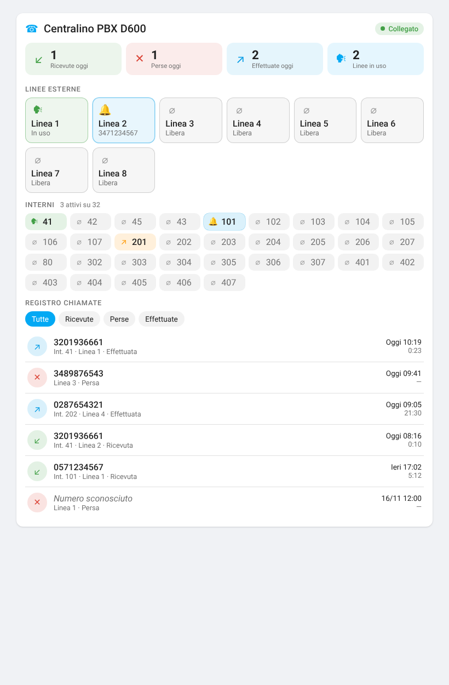

# PBX D600 per Home Assistant

Questo repository contiene due modi per collegare il centralino a Home Assistant. **Usane uno solo**: entrambi usano la porta UDP 50000.

- **Add-on con plancia (consigliato)**: si aggiunge da Impostazioni → Componenti aggiuntivi → Store → ⋮ → *Repository* → `https://github.com/stepsolar/ha-pbx-d600`. Installa poi "PBX D600". Aggiunge la voce **Centralino** nella barra laterale, con registro chiamate, rubrica e nomi degli interni. Vedi [la documentazione dell'add-on](pbx_d600_addon/DOCS.md).
- **Integrazione (HACS)**: descritta qui sotto.

Integrazione per il centralino gestito dal programma "PBX D600" (modello D832-L: 8 linee esterne, 32 interni). Home Assistant comunica **direttamente col centralino via UDP**, senza il PC.

## Cosa fa (versione 0.1)

- **Stato di ogni interno**, con il numero letto dal centralino (41, 42, 101, …): `libero`, `sganciato`, `squilla`, `in_linea_esterna`.
- **Stato di ogni linea esterna**: `libera`, `squilla`, `occupata`, con il numero del chiamante.
- **Sensore "Ultimo chiamante"**: numero, linea e ora.
- **Sensore "Collegamento"**: indica se il centralino risponde.
- **Sincronizzazione dell'ora**: ogni 30 secondi, come fa il programma originale.
- **Evento `pbx_d600_event`** per ogni messaggio, da usare nelle automazioni.
- **Servizi**:
  - `pbx_d600.sync_clock`
  - `pbx_d600.read_memory`: lettura della configurazione, innocua.
  - `pbx_d600.send_raw`: avanzato, da usare con cautela.

## Installazione

1. Copia la cartella `custom_components/pbx_d600` in `/config/custom_components/`. Puoi usare l'add-on "File editor" o "Samba share".
2. Riavvia Home Assistant.
3. **Chiudi il programma PBX D600 sul PC.** Il centralino invia gli eventi a un solo client.
4. Vai in Impostazioni → Dispositivi e servizi → Aggiungi integrazione → "PBX D600".
5. Inserisci l'IP del centralino (es. 192.168.x.x), la porta 50001, la porta locale 50000, 32 interni e 8 linee.

## Registro chiamate (dalla 0.2)

- **Sensori**: "Chiamate ricevute", "Chiamate perse" e "Chiamate effettuate".
  - Lo stato è il numero di chiamate di oggi.
  - L'attributo `chiamate` contiene le ultime 30, dalla più recente.
  - Ogni chiamata ha questi campi: direzione, linea, numero, interno, inizio, risposta, fine, durata (secondi), esito.
- **Persistenza**: il registro viene salvato e sopravvive ai riavvii (ultime 200 chiamate).
- **Evento `pbx_d600_call`**: viene emesso a fine chiamata, con tutti i dati.
- **Chiamate in uscita** (dalla 0.3): vengono riconosciute quando un interno impegna una linea esterna. Numero composto e durata arrivano dal riepilogo di addebito che il centralino invia a fine chiamata. L'integrazione conferma la ricezione del riepilogo, così il centralino smette di rinviarlo.
- **Messaggi non ancora decifrati**: finiscono nel sensore diagnostico "Messaggi non riconosciuti".

## Scheda per la dashboard (dalla 0.4)



L'integrazione include una scheda dedicata, **"Centralino PBX D600"**, che si registra da sola. Non serve installare risorse né usare HACS Frontend. La scheda mostra:
- lo stato del collegamento e i contatori di oggi (ricevute, perse, effettuate, linee in uso);
- le linee esterne, con il numero del chiamante quando squillano;
- la griglia degli interni (libero, sganciato, squilla, in linea);
- il registro chiamate, con le schede Tutte / Ricevute / Perse / Effettuate. Il numero è cliccabile per richiamare.

Per aggiungerla: modifica una dashboard → **Aggiungi scheda** → cerca **"Centralino PBX D600"**. In alternativa usa il codice YAML:

```yaml
type: custom:pbx-d600-card
title: Centralino          # opzionale
show_trunks: true          # opzionale
show_extensions: true      # opzionale
max_calls: 25              # opzionale
```

Per averla a tutto schermo: crea una nuova dashboard, poi apri la vista → **Modifica vista** → tipo di vista **Pannello (scheda singola)** e aggiungi la scheda.

## Esempio di automazione: notifica di chiamata in arrivo

```yaml
alias: Notifica chiamata in arrivo
triggers:
  - trigger: event
    event_type: pbx_d600_event
    event_data:
      type: caller_id
actions:
  - action: notify.notify
    data:
      title: "Chiamata in arrivo"
      message: "Linea {{ trigger.event.data.trunk }}: {{ trigger.event.data.number }}"
```

Tipi di evento: `off_hook`, `on_hook`, `ext_ringing`, `trunk_ringing`, `trunk_released`, `trunk_connected`, `caller_id`, `unknown`.

I messaggi non ancora decifrati arrivano come `unknown`, con il campo `raw`. Vengono scritti anche nel log, così si possono aggiungere in seguito.

## Protocollo (ricostruito)

UDP: Home Assistant usa la porta 50000, il centralino la 50001. Ogni frame ha questa forma:

`[LUNGHEZZA] [COMANDO] [dati…] [XOR di tutti i byte precedenti]`

| Direzione | Comando | Significato |
|---|---|---|
| HA→PBX | `03 h h m m s s` | imposta l'ora (heartbeat ogni 30 s); risposta `05 03 00 00 06` |
| HA→PBX | `04 01 AH AL 80` | legge 128 byte di memoria; la risposta riporta lo stesso header + i dati |
| PBX→HA | `10 P` / `11 P` | interno (porta P) sganciato / agganciato |
| PBX→HA | `14 P` | interno P squilla |
| PBX→HA | `17 T` / `18 T` | linea T squilla / si libera |
| PBX→HA | `80 T P` | linea T collegata all'interno P |
| PBX→HA | `08 T 01 N cifre` | caller ID (cifre BCD con nibble invertiti, 0xD = fine); HA risponde `08 T` |
| PBX→HA | `19 T` | linea T impegnata da un interno (chiamata in uscita) |
| PBX→HA | `01 T xx P D MM GG hh mm dh dm ds <8 byte cifre> <3 byte>` | riepilogo di fine chiamata (BCD), ripetuto finché HA non risponde `01 T` |

Le linee nei messaggi partono da 0 (T=0 è la linea 1), le porte degli interni partono da 1.

Memoria: la tabella dei numeri interni parte da `0x0300`, con 4 byte per porta.
